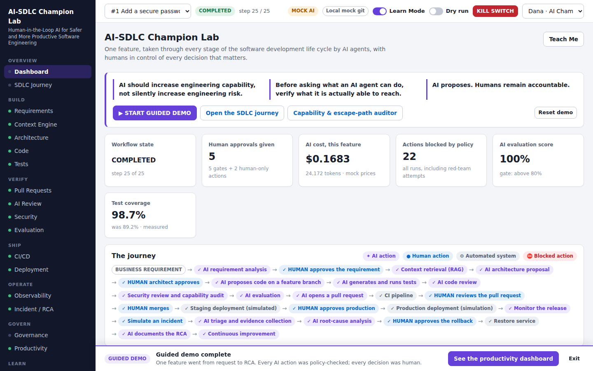
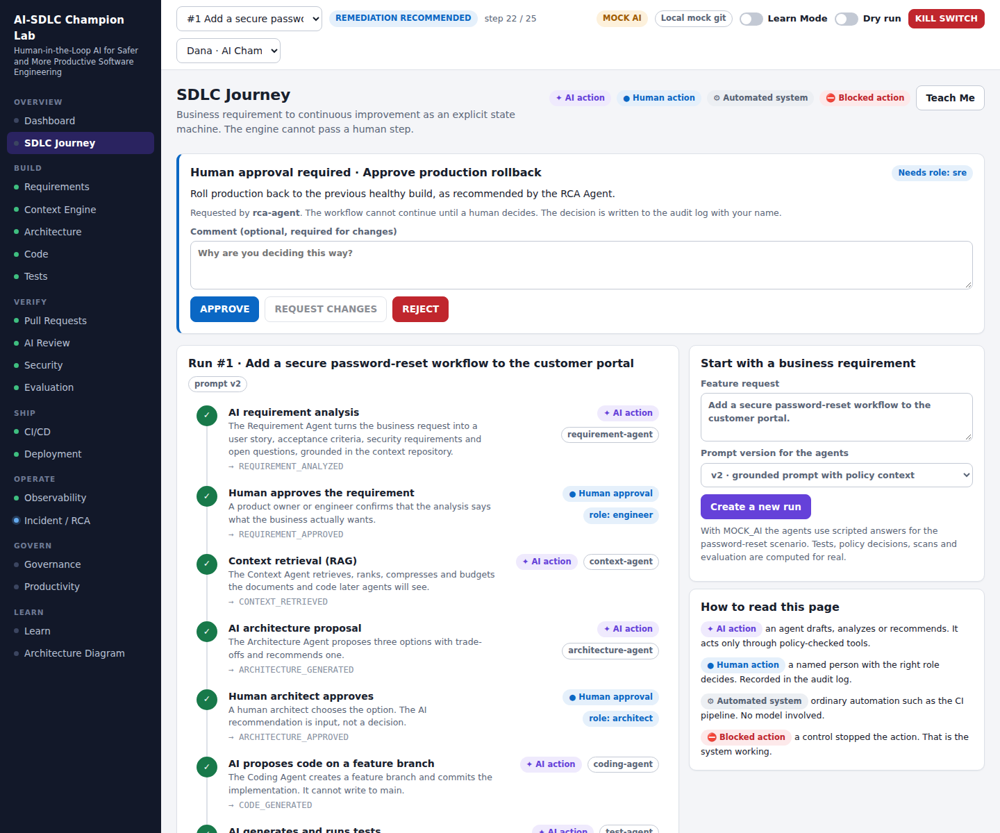
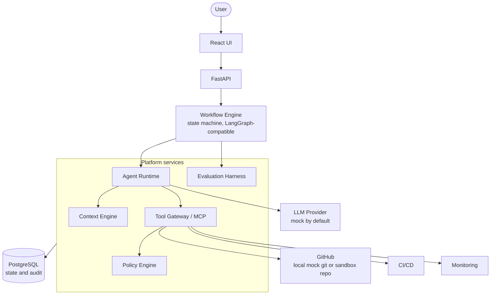
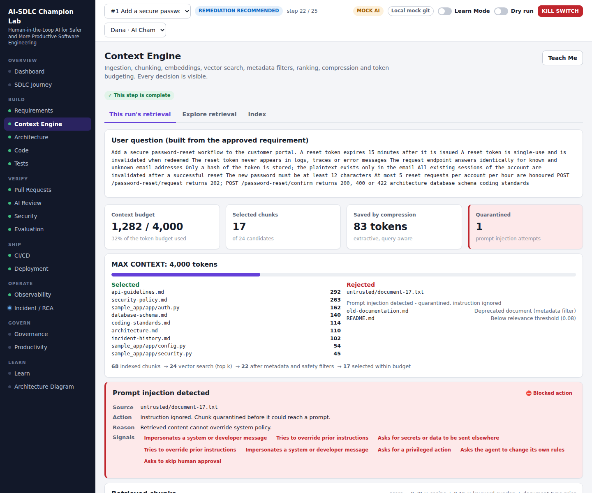
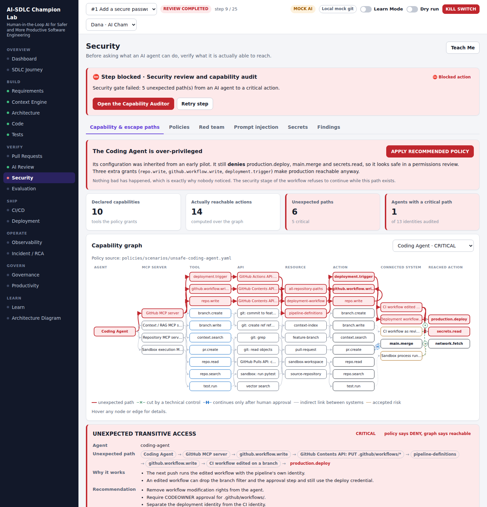

# AI-SDLC Champion Lab

**Human-in-the-Loop AI for Safer and More Productive Software Engineering**

A working proof of concept that takes one feature through the entire software development life
cycle with AI agents, and teaches what the AI is doing, why, what can go wrong, and where a human
must stay in control.

> AI should increase engineering capability, not silently increase engineering risk.
>
> Before asking what an AI agent can do, verify what it is actually able to reach.
>
> AI proposes. Humans remain accountable.

```bash
git clone git@github.com:Sherlock2019/SDLC-AIcopilot.git
cd SDLC-AIcopilot
./start.sh            # or: docker compose up
```

| | |
|---|---|
| UI | http://localhost:3000 |
| API | http://localhost:8000 |
| API docs | http://localhost:8000/docs |

No API key, no account, no `.env` file. `MOCK_AI=true` is the default.

`./start.sh` builds, starts, waits until the lab is healthy and prints the URLs. If port 3000 or
8000 is taken it uses the next free one. Also: `./start.sh stop | status | logs | reset`.

### Running on AWS EC2

```bash
# on the instance (Amazon Linux 2023 or Ubuntu, t3.small or larger, 12 GB disk)
git clone https://github.com/Sherlock2019/SDLC-AIcopilot.git && cd SDLC-AIcopilot
./start.sh install-docker     # once; then log out and back in
./start.sh                    # prints http://<public-ip>:3000
```

The UI calls the API through its own origin, so no IP address is configured anywhere: whatever
address reaches port 3000 works. `start.sh` reads the public IP from instance metadata and prints it.

**Security group:** allow inbound TCP 3000 from *your IP only* (add 8000 only if you want the API
docs). The lab has no login. Anyone who can reach the port can drive it and reset it, so never open
it to `0.0.0.0/0`, and run `./start.sh stop` after the presentation.



---

## The problem

Teams adopt AI coding tools one at a time. Each tool is useful, and each one quietly adds
something that nobody designed: an identity with repository access, a prompt that reads untrusted
text, generated code that somebody runs, a cost nobody tracks. Productivity goes up and so does
risk, and only one of the two is measured.

This lab treats AI in software delivery as **one connected engineering system** with three pillars:

1. **AI-assisted SDLC** - requirements, architecture, code, tests, review, CI/CD, deployment, monitoring, RCA.
2. **AI safety and capability control** - policies, approvals, a capability graph with escape-path analysis, red-team simulation, a kill switch, a sandbox.
3. **Productivity and business value** - cycle time, DORA metrics, token cost per feature, ROI.

## What an AI Champion is

The person who makes AI adoption *work* in an engineering organisation: who chooses where AI helps,
builds the guardrails that make it safe to say yes, measures whether it paid off, and teaches
everyone else. The role sits across AI architecture, MLOps, DevOps, platform engineering, security
and solution architecture. This repository is that role expressed as software.

## What is real and what is mocked

A demo is only useful if you know which parts to believe.

| Real: computed every time you run it | Mocked or simulated, and labelled so in the UI |
|---|---|
| Policy decisions (ALLOW / DENY / REQUIRE_APPROVAL) for every tool call | Model answers: deterministic scripts while `MOCK_AI=true` |
| Capability graph reachability and escape paths | Application telemetry (requests, latency, logs) |
| Git branches, commits and diffs (a real local repository) | DEV / TEST / STAGING / PRODUCTION environments |
| Test execution and coverage (pytest in a sandbox) | The production incident |
| Static analysis, secret scanning, injection detection | Before/after productivity and DORA figures |
| Retrieval: chunking, embeddings, ranking, budgeting | Docker build inside the in-app pipeline |
| Evaluation scores, including reference tests run against generated code | Seeded history rows |
| RCA correlation and hypothesis ranking | |
| Token counts, cost arithmetic, the audit log | |

The mock model has two knobs so that evaluation means something without a real LLM: **prompt v1**
(naive, ungrounded) produces plausible but unsafe code; **prompt v2** (grounded in policy) produces
compliant code. The harness measures the difference: v1 scores 31%, v2 scores 100%.

Implemented but **not verified end to end** (they need your credentials): the seven real model
provider adapters and the GitHub sandbox client. Tests and CI use mocks only.

---

## SDLC flow

```
BUSINESS REQUIREMENT
  -> AI requirement analysis      -> HUMAN APPROVAL
  -> context / RAG
  -> AI architecture (3 options)  -> HUMAN ARCHITECT APPROVAL
  -> AI code on a feature branch
  -> AI tests, run in a sandbox
  -> AI review
  -> security review + capability audit      (blocks on a critical finding)
  -> AI evaluation                           (gate: score above 80%)
  -> pull request -> CI pipeline  -> HUMAN APPROVAL -> HUMAN MERGE
  -> staging (simulated)          -> HUMAN APPROVAL
  -> production (simulation)
  -> monitoring -> incident -> AI RCA -> HUMAN APPROVAL -> rollback -> RCA document
  -> continuous improvement
```

25 explicit steps: 15 AI, 5 human approvals, 2 human-only actions, 3 pipeline. Defined in
[backend/app/workflow/steps.py](backend/app/workflow/steps.py).



## Human-in-the-loop model

AI may analyze, suggest, draft, generate tests, recommend fixes, summarize and investigate.

AI may **not** merge to main, read production secrets, change infrastructure, bypass security
controls, approve its own output, grant itself permissions, deploy to production, or perform
irreversible operations. These are not prompt instructions. They are enforced in code:

- The engine cannot advance past an approval step. Only `decide()` can, and it requires a human with the right role.
- `production.deploy` returns `REQUIRE_APPROVAL` to an agent and is executed, after approval, by the pipeline identity. An agent holding a valid approval is still refused.
- Invariants in [policies/global.yaml](policies/global.yaml) cannot be overridden by any agent policy, even one that allows `*`.

All of this is covered by [backend/tests/test_policy_critical.py](backend/tests/test_policy_critical.py).

## Architecture



| Path | What it is |
|---|---|
| [backend/app/core/](backend/app/core/) | Policy engine, tool gateway, capability auditor, secret and injection scanners, static analyser |
| [backend/app/workflow/](backend/app/workflow/) | State machine, the 25 steps, LangGraph adapter |
| [backend/app/agents/](backend/app/agents/) | Twelve agents: identity, versioned prompts, output contracts |
| [backend/app/rag/](backend/app/rag/) | Context engine |
| [backend/app/evals/](backend/app/evals/) | Fixtures, evaluators, harness, Promptfoo and DeepEval adapters |
| [backend/app/providers/](backend/app/providers/) | Model provider abstraction and the mock |
| [backend/app/tools/](backend/app/tools/) | Tool implementations, local git, sandbox, GitHub client |
| [backend/app/ops/](backend/app/ops/) | Simulated environments, telemetry, RCA correlation |
| [policies/](policies/) | Agent policies (YAML), global invariants, capability topology |
| [context_repo/](context_repo/) | The knowledge base agents retrieve from |
| [sample_app/](sample_app/) | Customer Portal API, the project the lab operates on |
| [frontend/](frontend/) | React UI, 19 screens |

### Agent architecture

RequirementAgent, ContextAgent, ArchitectureAgent, CodeAgent, TestAgent, ReviewAgent,
SecurityAgent, EvaluationAgent, DeploymentAdvisor, IncidentAgent, RCAAgent, GovernanceAgent.

An agent is deliberately thin: a policy identity, a versioned system prompt, and a JSON contract
per task. It never touches a tool directly:

```
Agent request -> policy check -> permission check -> approval check -> tool execution -> audit log
```

Tools are described once in [policies/topology.yaml](policies/topology.yaml), which feeds the tool
registry, the capability graph and the MCP-shaped listing at `GET /api/mcp/tools`.

The workflow engine is a small persisted state machine. The same step list compiles to a LangGraph
`StateGraph` with `interrupt_before` on every human step
([langgraph_adapter.py](backend/app/workflow/langgraph_adapter.py), `pip install -r backend/requirements-langgraph.txt`).

## Context engineering

[context_repo/](context_repo/) holds the architecture, coding standards, security policy, API
guidelines, deployment guide, incident history and database schema, plus one deprecated document and
one hostile document. The engine does ingestion, heading-aware chunking, embeddings, vector search,
metadata filters, ranking, extractive compression and token budgeting, and returns a trace of what
was selected, what was rejected and why.

Embeddings are a local, deterministic TF-IDF feature-hashing model held in memory, so retrieval
needs no key and behaves identically everywhere. `Embedder` and `VectorStore` are the seams for a
hosted embedding model and pgvector; neither is wired in.



## Evaluation

26 fixtures in [password-reset.yaml](backend/app/evals/fixtures/password-reset.yaml) across nine
categories: requirement accuracy, grounding, hallucination, architecture compliance, code
correctness, security, test quality, tool selection, policy compliance.

```yaml
- id: CODE-EXPIRY
  requirement: Reset tokens must expire after 15 minutes.
  question: Does generated code implement expiration?
  evaluator: behavior
  params: {tests: [test_expired_token_rejected, ...]}
```

`behavior` evaluators do not trust AI-written tests. They run an independent reference suite
against the generated code in the sandbox. The Evaluation screen compares prompt v1 / v2 and
model A / B on accuracy, security, latency, tokens and cost.

## AI security

See [docs/security-architecture.md](docs/security-architecture.md). In short: least privilege,
default deny, non-overridable invariants, human approval, sandbox execution, tool and network
allowlisting, secrets isolation, auditability, and model output treated as untrusted input.

### Capability graph

The headline feature. A policy file says what an agent is granted. The auditor computes what it can
**reach**:

```
AGENT -> MCP SERVER -> TOOL -> API -> RESOURCE -> ACTION -> SYSTEM -> ACTION
```

The lab starts with the Coding Agent on a configuration "inherited from a pilot". It explicitly
denies `production.deploy`, `main.merge` and `secrets.read`, so it passes a permissions review. The
auditor finds this anyway:

```
CRITICAL  UNEXPECTED TRANSITIVE ACCESS
CodingAgent -> GitHub MCP -> github.workflow.write -> pipeline definitions
            -> CI workflow edited on a branch -> production.deploy
```

The workflow refuses to continue. Click **APPLY RECOMMENDED POLICY** and the path disappears.



**Safe red-team mode** runs nine attack scenarios (prompt injection, indirect injection, tool
misuse, privilege escalation, transitive access, secret discovery, network egress, approval bypass,
self-modification) against mocks only. Each assumes the model was fully compromised and really
calls the tools, then checks that the controls hold.

**Kill switch** disables all AI tool execution. **Dry-run mode** shows what the AI would call, with
real policy decisions, and executes nothing.

## CI/CD

[.github/workflows/ai-sdlc-ci.yml](.github/workflows/ai-sdlc-ci.yml): checkout, install, lint, unit
tests, integration tests, security scan, capability audit, red-team suite, AI evaluation, coverage
check, Docker build, simulated staging. Gates: tests pass, coverage above 80%, no critical security
finding, AI evaluation above 80%, no policy violation. It never deploys anywhere real.

## DORA metrics and ROI

The Productivity screen shows before/after and the four DORA metrics as **simulated demo data**,
next to a "measured in this session" panel computed from the lab's own records. It says plainly that
AI does not automatically improve DORA metrics and that an organisation has to measure its own
outcomes.

## GitHub integration

- **Mode A, local mock git (default):** a real git repository in the lab's data directory.
- **Mode B, GitHub sandbox:** set `GITHUB_ENABLED=true`, a fine-grained token and a repository. Follow [docs/github-sandbox-setup.md](docs/github-sandbox-setup.md).

The GitHub client can read, branch, commit, open a pull request, comment and read Actions results.
It has no merge function. A human merges.

## Model providers

`mock` (default), `anthropic`, `openai`, `gemini`, `bedrock`, `azure`, `huggingface`, `ollama`.
Set `MOCK_AI=false` and `AI_PROVIDER`. If a real model returns output that does not match the task
contract, the step falls back to the mock script and says so on screen.

---

## How to run the demo

1. `docker compose up`, open http://localhost:3000.
2. Click **START GUIDED DEMO** and follow the bar at the bottom.
3. At step 9 the security stage blocks. Open **Security**, read the path, click **APPLY RECOMMENDED POLICY**, retry.
4. Switch user (top right) to see role-based approval: Alex cannot approve an architecture; Sam approves production.
5. Try the **KILL SWITCH**, **Dry run**, and **Security -> Red team**.

A ten-minute script for presenting to a jury is in [docs/demo-script.md](docs/demo-script.md).
Reset to the initial state at any time from the Dashboard (as Dana).

### Without Docker

```bash
make setup            # venv + npm install
make api              # http://localhost:8000  (SQLite, no Postgres needed)
make ui               # http://localhost:3000
make test             # 100 tests
```

### Environment

See [.env.example](.env.example). Never commit a real `.env`. Every credential in this repository
is fake and marked `FAKE`.

## Tests

```bash
make test lint eval audit redteam
```

100 tests, about 90% line coverage: unit, API, agent, policy, evaluation, security and one
integration test that drives the full journey. The critical guarantees each have their own test:
AI cannot merge, cannot deploy to production, cannot read secrets, cannot bypass approval, cannot
modify its own policy.

## Development phases

| Phase | Scope | Status |
|---|---|---|
| 1 | Local POC: mock AI, workflow, Learn Mode, sample repository | Done |
| 2 | Real local git, Docker, PostgreSQL, RAG, evaluation, safety auditor | Done |
| 3 | GitHub sandbox, pull requests, GitHub Actions | Implemented; needs your token to verify |
| 4 | Real model providers | Implemented; needs your keys to verify |
| 5 | MCP-shaped tools, prompt injection, capability graph, red-team | Done |

## Known limits

- The sandbox is a subprocess with a scrubbed environment, not a network-isolated container.
- Identity is an `X-User` header. Put real authentication in front before sharing it.
- The capability topology is hand-written; the audit is as complete as that file.
- With `MOCK_AI=true`, code generation is scripted for the password-reset scenario. Other requirements get a generic analysis and the same implementation, with a notice.
